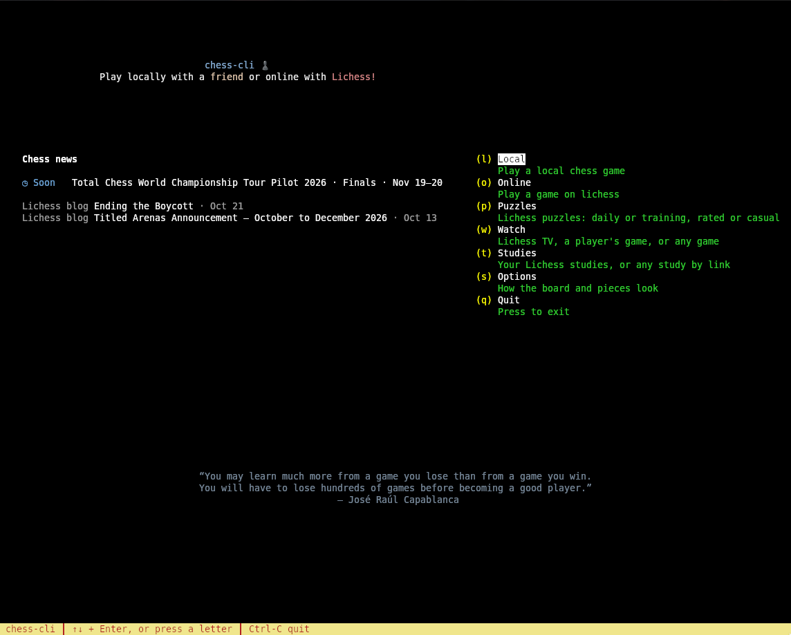
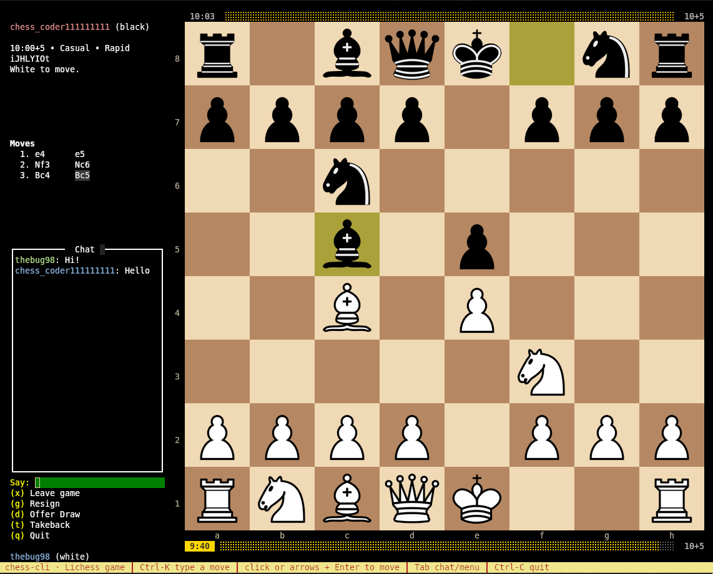
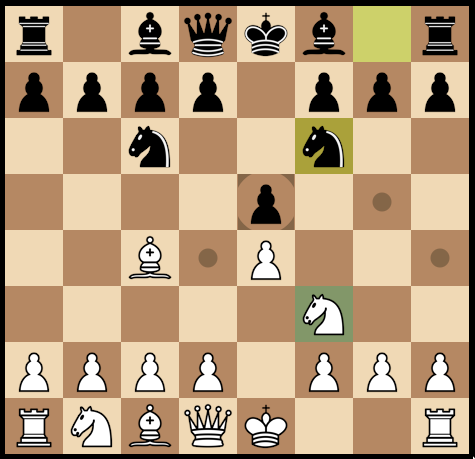
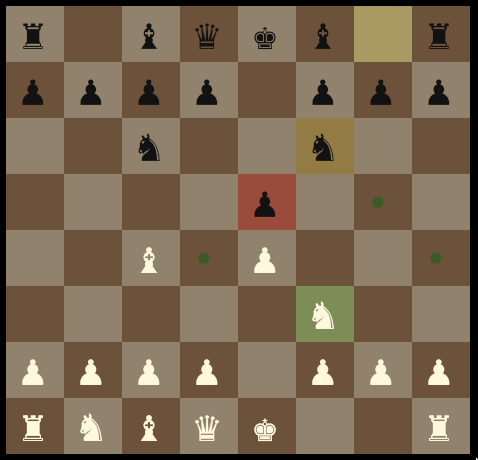
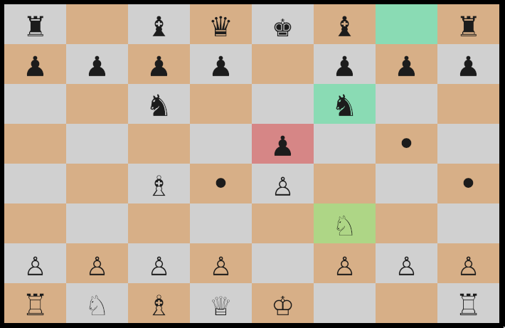
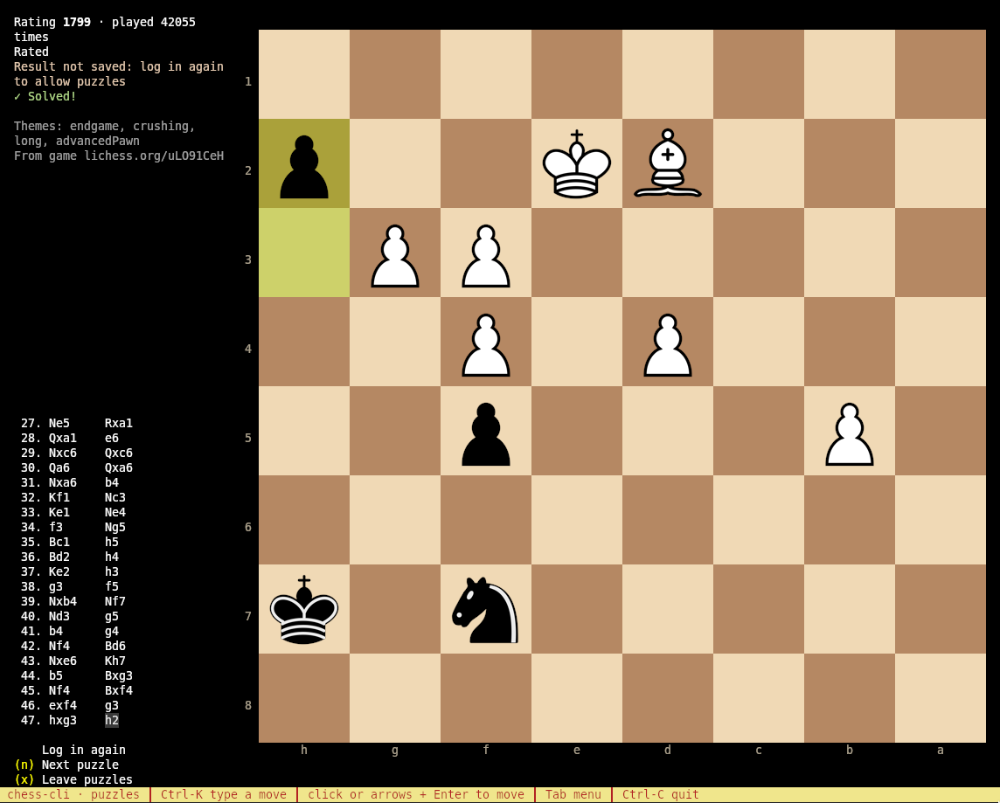
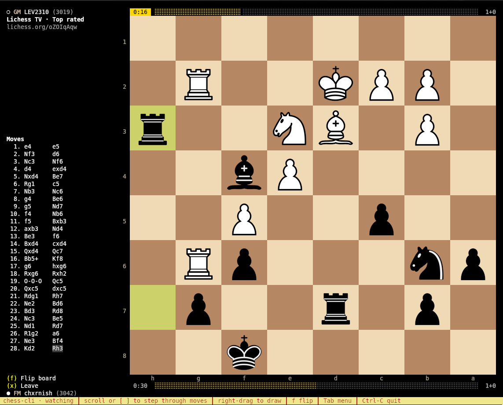
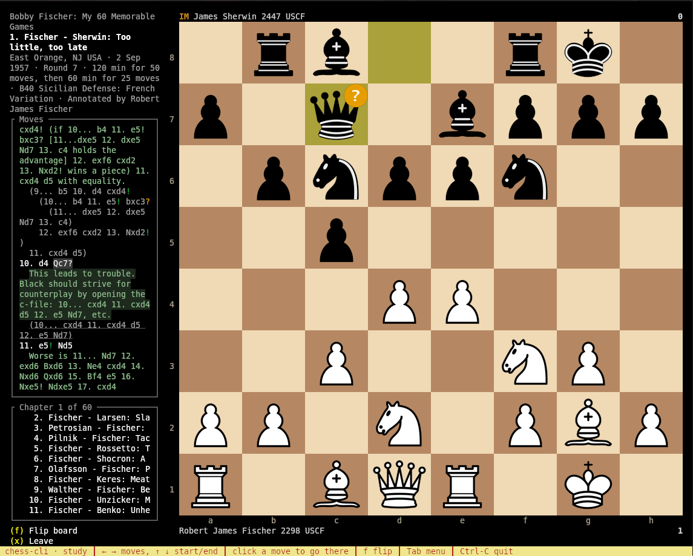

<!-- # chess-cli ♟️ -->
<h1 align='center'>chess-cli ♟️</h1>
<p align="center">
  <b>A chess tui app written in Go.</b><br/>
  <sub>Play locally with a friend or online with Lichess!</sub>
</p>
<br />

<p align="center">♞♞♞♞♞♞♞♞♞♞♞</p>

chess-cli is a tui (terminal user interface) that allows you to play chess, both offline with a friend or online as a Lichess api client.




<p align="center">♞♞♞♞♞♞♞♞♞♞♞</p>

# Install

**Download a binary** for Linux, macOS or Windows from the
[releases page](https://github.com/nate-xyz/chess-cli/releases), unpack it and
run `chess-cli`.

**Or install with Go** (1.24+):

```sh
go install github.com/nate-xyz/chess-cli@latest
```

**Or build from source:**

```sh
git clone https://github.com/nate-xyz/chess-cli
cd chess-cli
go run .            # or: go build -o chess-cli . && ./chess-cli
```

A terminal with true colour and a font with the Unicode chess symbols gives the
best result. The board scales with your terminal, so make it big.

### How the board looks

Choose under **Options** on the home screen:

| Rendering | What you get | Where |
|---|---|---|
| **Image** | Lichess boards and piece sets as real images, scaled to the board. 12 piece sets and 6 boards, previewed as you pick | terminals with the [kitty graphics protocol](https://sw.kovidgoyal.net/kitty/graphics-protocol/): kitty, Ghostty, WezTerm |
| **Advanced** | Unicode chess symbols, drawn big with kitty's [text sizing protocol](https://sw.kovidgoyal.net/kitty/text-sizing-protocol/) where available | everywhere; big in kitty 0.40+ |
| **Basic** | Plain symbols in the terminal's 8 standard colours, like the original chess-cli | any terminal, including old ones |

<table>
  <tr>
    <td align="center"><br><sub>Image</sub></td>
    <td align="center"><br><sub>Advanced</sub></td>
    <td align="center"><br><sub>Basic</sub></td>
  </tr>
</table>

Support is detected at startup (image rendering falls back to advanced where
images aren't supported, e.g. inside tmux). `CHESS_CLI_IMAGES=0/1` and
`CHESS_CLI_BIG_PIECES=0/1` override the detection.

Options also has:

- **Move box**: typed-move box always shown, or only on `Ctrl-K`
- **Clock bar**: clocks as a bar beside the board, or plain text in the sidebar
- **Zen mode**: hides names, ratings, chat and game info during games, like
  Lichess's zen mode
- **Sound**: Retro (chiptune) or Wood, or off. chess-cli's own sounds,
  played with your system's player (`pw-play`, `paplay` or `aplay` on Linux,
  `afplay` on macOS, built in on Windows)

# Playing

| | |
|---|---|
| **Mouse** | Click a piece, then click where it should go. Legal moves are dotted, captures marked. |
| **Typing** | `Ctrl-K` opens the move box: UCI (`e2e4`) or standard notation (`Nf3`, `exd5`, `O-O`). Promotions need the piece: `e7e8=Q`, `e8=Q` or `e7e8q`. |
| **Keyboard on the board** | Arrows or `hjkl` move the cursor, `Enter`/`Space` selects, `Esc` cancels, `Tab` goes to the menu. |
| **Going back** | Click a move in the move list, scroll the mouse wheel on the board, or `[` `]` (`Home`/`End` for the start/now). Click the board to return. Works on the game-over screen too. |
| **Drawing** | Right-click a square for a circle, right-drag for an arrow; `Shift` red, `Alt` blue, both yellow. Left-click clears. |
| **Promotion** | A picker opens over the promotion square: click a piece, or press `q` `r` `b` `n`. |
| **Online chat** | `Tab` cycles board → chat → menu. |

Local games are two players on one keyboard; the board flips each move. Games
can be saved and resumed.

# Puzzles

*Puzzles* on the home screen: the **daily puzzle**, or **puzzle training**
(new puzzles one after another, five difficulty levels relative to your
rating). **Rated** puzzles update your Lichess puzzle rating and need a login;
**casual** ones work without. Hints, solutions and themes as on Lichess.



# Watching, studies and news

Once you've logged in to Lichess, the home screen also has:

- **Watch**: Lichess TV channels (top rated, bullet, blitz, rapid, classical,
  Chess960, bots, computer), a player's current game, or any game by link or
  ID. Live clocks and moves; scroll back through the game as usual.
- **Studies**: your Lichess studies (private ones too) or any study by link.
  Chapters, variations, comments and the study's arrows and circles. `←` `→`
  step through the moves, `↑` `↓` jump to the start/end, click any move
  (in a variation too) to go there.
- **Chess news**: elite events Lichess is broadcasting (live, coming up, just
  finished, with leaders and winners) and the latest Lichess blog posts.




Without a login chess-cli doesn't contact Lichess at all (casual puzzles
aside, which you choose explicitly).

# Lichess

Choose *Lichess* on the home screen and log in through your browser (if it
doesn't open, the link is shown in the app). chess-cli uses the
[Lichess Board API](https://lichess.org/api#tag/board):

- Challenge a friend, seek a random opponent, or play Lichess's Stockfish (levels 1–8)
- All variants, rated or casual, real-time, correspondence or unlimited
- Resume ongoing games; accept, decline (`d`) and cancel challenges
- Chat, draw offers, takebacks, resign/abort
- Claim victory or a draw when your opponent leaves
- Rematch from the game-over screen
- `Esc` on the waiting screen withdraws your challenge or seek

**Time controls:** Lichess only allows Rapid, Classical and Correspondence
through the Board API, plus Blitz for direct challenges and games against the AI.
Bullet isn't available to third-party clients.

Only one chess-cli runs at a time; a second copy tells you one is already
running.

Your Lichess token and saved games are kept in `~/.config/chess-cli`
(`chess-cli --help` prints the exact folder on your system).

<p align="center">♞♞♞♞♞♞♞♞♞♞♞</p>

# Development

```sh
go test -race ./...
```

The tests include an end-to-end online game: the real UI running on tcell's
mock terminal against a fake Lichess server.

**Releasing:** push a version tag and GitHub Actions builds and publishes the
binaries with [GoReleaser](https://goreleaser.com):

```sh
git tag v0.2.0 && git push origin v0.2.0
```

### Credits

Piece sets come from [Lichess](https://github.com/lichess-org/lila); each
keeps its own licence (GPL, MIT, Apache, CC0, CC BY, CC BY-SA). See
[pkg/assets/pieces](pkg/assets/pieces/README.md).

### Dependency documentation

- [Lichess API](https://lichess.org/api)
- [notnil/chess](https://pkg.go.dev/github.com/notnil/chess): rules and move generation
- [cview](https://pkg.go.dev/codeberg.org/tslocum/cview): TUI widgets
- [tcell](https://pkg.go.dev/github.com/gdamore/tcell/v3): terminal handling

<p align="center">♞♞♞♞♞♞♞♞♞♞♞</p>

### Todo

#### general

- Sixel support for image rendering (foot, Konsole, xterm, Windows Terminal)

#### local client

- Save clock times with saved games
- Stockfish analysis of a finished game

#### online

- Challenge construction
  - Set default positions for sliders
  - Custom starting position
- Puzzle themes, opening explorer, game history/PGN export
- Variants: the board follows standard chess rules only. Games in variants
  like crazyhouse or atomic can be created but the app can't follow them yet;
  Chess960 is untested.

<p align="center">♞♞♞♞♞♞♞♞♞♞♞</p>
